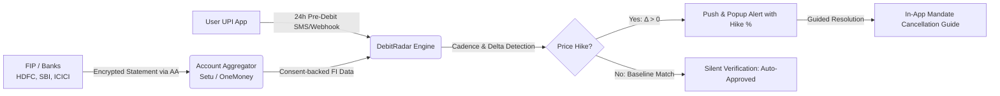

# DebitRadar - Subscription Price-Hike Detector

> **Track:** FinTech | **Initiative:** hackFront India 2026 (Where U Elevate)  
> **Core Focus:** UPI AutoPay Mandate Protection, Account Aggregator (AA) Architecture, Lucide Icons & Consumer FinTech

---

## Elevator Pitch
**DebitRadar** detects stealth subscription price increases on UPI AutoPay **before** money leaves your bank account, and provides a guided non-custodial workflow to cancel unwanted charges in seconds.

---

## The Problem and Regulatory Insight

### The Status Quo Problem:
Users in India are signing up for recurring monthly/quarterly subscriptions (Netflix, Hotstar, Spotify, ChatGPT, Google One) via UPI AutoPay. When service providers silently hike subscription prices (+15% to +40%), users don't realize until months of extra debits have accumulated.

### The Regulatory Foundation (RBI Master Direction):
Under RBI's e-mandate framework (*RBI/2019-20/47 DPSS.CO.PD No.1324/02.14.003/2019-20*), banks **must** send a pre-debit notification to the customer at least **24 hours before** an auto-debit happens.

> **The Missing Link:**  
> The bank's SMS simply states: *"₹249 will be debited tomorrow for Netflix."*  
> Banks **do not tell you** what you paid last month (₹199).  
> **DebitRadar is the intelligence layer on top of this 24-hour notice.** It intercepts/compares this notice against your historical baseline and sounds the alarm only when a price hike occurs.

---

## System Architecture (Technical Depth)

DebitRadar operates on India's official **Account Aggregator (AA)** ecosystem as an authorized **Financial Information User (FIU)**:



### 1. Detection Algorithm:
* **Recurring Cadence Filter:**
  $$\Delta t = |t_i - t_{i-1}| \approx 30 \pm 2 \text{ days (Monthly)} \quad \text{or} \quad 90 \pm 3 \text{ days (Quarterly)}$$
* **Noise Filter:** One-off merchant transactions (Swiggy, Uber) are eliminated via cadence variance and merchant classification.
* **Price Delta Formula:**
  $$\text{Hike \%} = \frac{P_{\text{new}} - P_{\text{baseline}}}{P_{\text{baseline}}} \times 100$$

---

## Named User and Credible Payer (Business Model)

| Dimension | Details |
| :--- | :--- |
| **Named User** | **Rohan Sharma (27)**, Product Designer in Bengaluru. Manages 7 active auto-debits (Netflix, Spotify, ChatGPT, Prime, Cult.fit). Loses ~₹2,800/yr to unnotified stealth price increases. |
| **Credible Payer 1 (B2B2C - Primary)** | **Neo-banks & Personal Finance Apps (Fi, Jupiter, CRED, INDmoney):** License DebitRadar as an SDK/white-label widget. Increases monthly active users (MAU) and positions them as consumer advocates. |
| **Credible Payer 2 (B2C - Freemium)** | Free tier covers up to 3 subscriptions. **Pro Tier (₹39/month)** covers unlimited multi-bank sync, instant WhatsApp alerts, and priority mandate resolution. |

---

## Live Prototype and Scenarios

The prototype is a self-contained, zero-dependency simulator replicating the complete mobile onboarding, bank consent, and real-time pre-debit alert experience.

### Included Test Scenarios (For Evaluators):
1. **Scenario A (Netflix):** Baseline ₹199 -> Pre-debit notice ₹249 (**+25.1% hike detected**). Shows resolution workflow.
2. **Scenario B (Hotstar):** Baseline ₹299 -> Pre-debit notice ₹399 (**+33.4% hike detected**).
3. **Scenario C (Spotify):** Baseline ₹119 -> Pre-debit notice ₹119 (**Normal payment**). Proves intelligent noise-reduction without triggering false alarms.

---

## Tech Stack
* **Frontend:** HTML5, CSS3, JavaScript (ES6+)
* **Icons:** Lucide Icons (Official CDN integration)
* **Design System:** IBM Plex Mono & IBM Plex Sans
* **Standards:** Sahamati Account Aggregator FIU Specification & RBI e-mandate Directive

---

## Quick Start & Live Demo

* **Live Demo:** [https://oscoading.github.io/debit-radar/](https://oscoading.github.io/debit-radar/)
* **Repository:** [https://github.com/oscoading/debit-radar](https://github.com/oscoading/debit-radar)

To run locally, simply clone and open `index.html`:
```bash
# Clone the repository
git clone https://github.com/oscoading/debit-radar.git

# Open directly in browser
start index.html
```

---

## License
MIT License - Open-source for hackFront India 2026.
